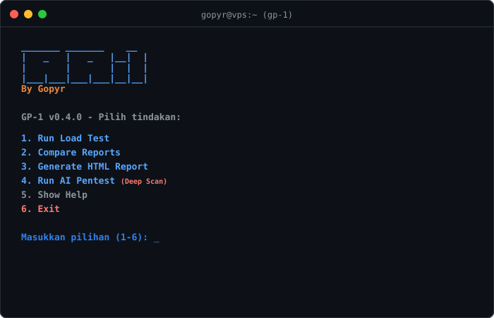
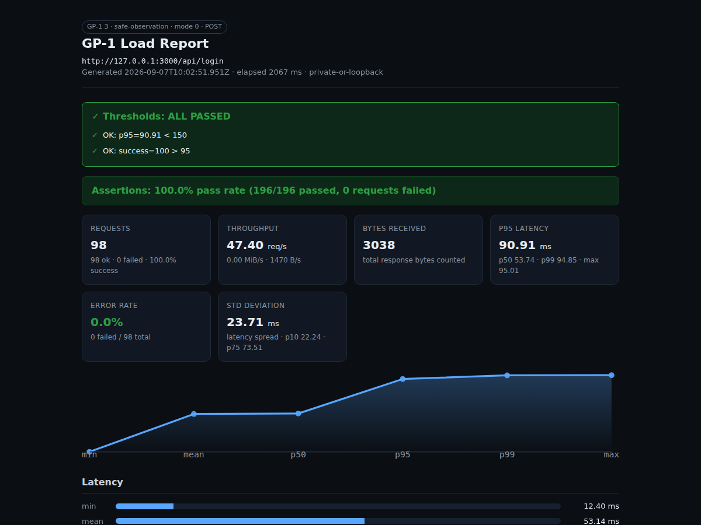

# GP-1

[](https://github.com/Gopyr/GP-1/actions)
[](https://opensource.org/licenses/MIT)

GP-1 menggabungkan dua hal yang biasanya terpisah dalam satu CLI: load testing HTTP dan penetration testing berbasis AI (via Strix). Dibuat untuk developer yang ingin menguji performa sekaligus audit keamanan sebelum aplikasi masuk produksi.



## Fitur

- Menu interaktif: jalankan `gp-1` tanpa argumen.
- Load testing dengan concurrency tinggi, ticker performa real-time, dan visualisasi distribusi latensi di terminal.
- Penetration testing otomatis (SQL Injection, IDOR, dsb.) menggunakan AI Strix, baik white-box (audit kode) maupun black-box (scan web).
- Threshold otomatis: tentukan batas sukses (misal p95 latency < 200ms) dan pipeline CI/CD akan gagal jika performa turun di bawahnya.
- Laporan HTML interaktif yang berdiri sendiri, tanpa dependensi luar.

## Metode Pengujian

### Load Testing
Pool worker asinkron berbasis Node.js untuk menguji kestabilan endpoint:
- Semua HTTP method: GET, POST, PUT, PATCH, DELETE.
- Request body (string atau file), kustom headers, Bearer token, cookies, Basic Auth.
- Ramping concurrency: naik-turunkan beban worker per stage, misal `5:10s,50:30s,5:10s`.
- Ekspor JSON, CSV, dan NDJSON stream.

### AI Pentesting
Audit keamanan terpandu dengan Strix AI Engine:
- White-box: audit source code lokal, celah dilaporkan langsung di baris kodenya.
- Black-box: scan URL target secara aktif untuk mencari celah eksploitasi.
- Deep-scan analisis mendalam default untuk menangkap celah kritis.

## Cara Penggunaan

Mode interaktif:
```bash
node src/cli.mjs
```

Mode argumen (CI/CD / skrip):

Load testing standar:
```bash
node src/cli.mjs -u http://localhost:3000/api -d 10 -c 50
```

Load testing dengan ramping (tahapan beban):
```bash
node src/cli.mjs -u http://localhost:3000/api -r "5:10s,50:30s,10:10s"
```

AI penetration testing (target lokal/direktori):
```bash
export LLM_API_KEY="your-9router-key"
node src/cli.mjs pentest ./src --pentest-confirm
```

## Preview Laporan HTML

Hasil uji bisa diekspor langsung menjadi file HTML interaktif mandiri (nol dependensi luar):



## Disclaimer

GP-1 menyertakan fitur penetration testing. Gunakan hanya di sistem lokal atau sistem yang Anda miliki secara sah. Penyalahgunaan untuk aktivitas ilegal atau tanpa izin bukan tanggung jawab pengembang.

## Lisensi

[MIT License](LICENSE)
